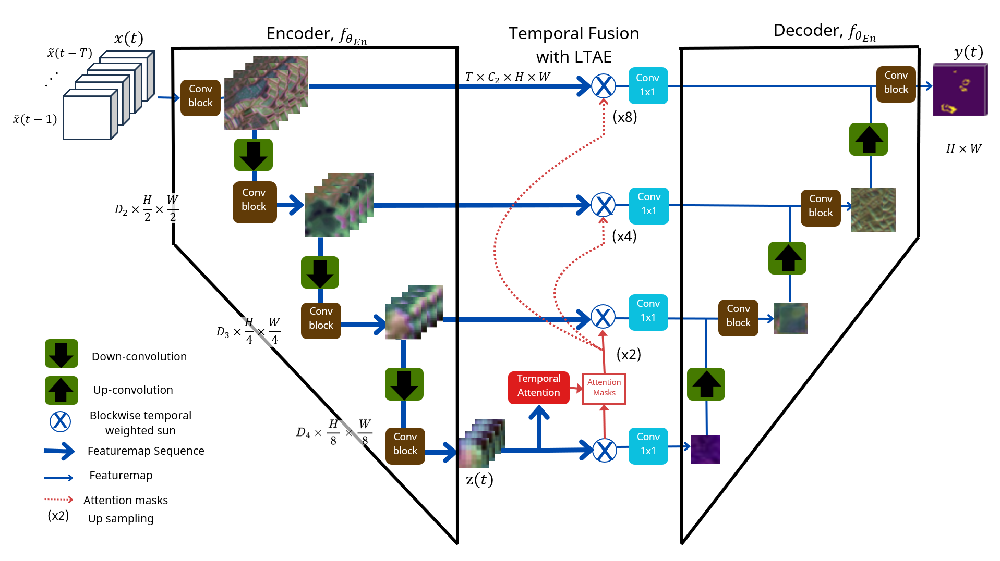
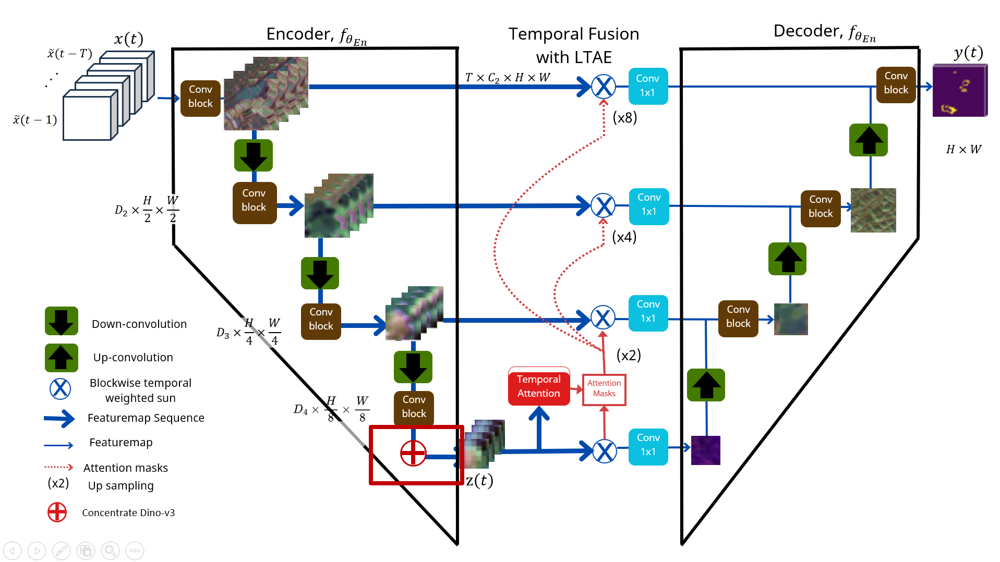

# UTAE + DINOv3 for Wildfire Spread Prediction

This project integrates a **pretrained DINOv3 Vision Transformer (ViT)** into the deepest encoder stage (**stage 3**) of **UTAE** (U-Net with Temporal Attention Encoder) for pixel-wise next-day wildfire spread prediction from satellite/weather time series. It builds on the [WildfireSpreadTS](https://github.com/SebastianGer/WildfireSpreadTS) benchmark (`BaseModel`, `UTAE`) and re-implements the DINOv3 ViT, its Gram loss and its KoLeo loss in a single self-contained file.

**Status: integration implemented; evaluation pending.** This README documents the architecture, the training objective and the usage of the code. No benchmark numbers are reported yet (see [Results](#results)).

Contents: [Overview](#project-overview) · [Data pipeline and original UTAE](#data-pipeline) · [DINOv3 integration](#dinov3-integration) · [Training and loss](#training-and-loss) · [Environment and setup](#setup) · [Run and verify](#run-and-verify) · [Configuration reference](#configuration) · [Results](#results) · [Troubleshooting](#troubleshooting) · [Limitations](#limitations) · [References](#references)

<a id="project-overview"></a>

## 1. Project Overview

| Item | Current scope |
| --- | --- |
| Task | Binary semantic segmentation: predict the next-day fire mask from a multi-day time series |
| Intended readers | Students, researchers and reviewers reproducing or extending the integration |
| Base framework | WildfireSpreadTS (`BaseModel`, PyTorch Lightning) + UTAE |
| Model input | `[B, T, C, H, W]` (B batch, T days, C input channels, H×W pixels) plus optional day-of-year (DOY) positions `[B, T]` |
| Model output | `[B, 1, H, W]` fire logits (`sigmoid` gives fire probability) |
| Added backbone | DINOv3 ViT (`dinov3_vits16` by default, LVD-1689M pretraining) |
| Where DINOv3 is added | **Stage 3** of the UTAE encoder (spatial resolution H/8 × W/8); optionally stage 2 as well |
| Everything else | UTAE's L-TAE temporal encoder, attention-based temporal aggregation and U-Net decoder are unchanged |

The two questions this README answers are:

1. **How is DINOv3 integrated?** DINOv3 runs on every day of the input in parallel, and its patch features are fused into the UTAE stage-3 feature map with a **zero-initialised gate**, so training starts exactly from the UTAE behaviour. See [Section 3](#dinov3-integration).
2. **How does the integrated model learn?** The segmentation loss is combined with a Dice loss and two DINOv3-specific regularisers (Gram anchoring and KoLeo), and the ViT is unfrozen gradually with smaller learning rates. See [Section 4](#training-and-loss).

<a id="data-pipeline"></a>
<a id="original-utae"></a>

## 2. Data Pipeline and Original UTAE

### 2.1 Data collection and preprocessing


*Figure 1. End-to-end data pipeline: from raw multi-source observations to the model input and the prediction/evaluation stage.*

The pipeline follows the WildfireSpreadTS benchmark and is **not modified by this project**; this section describes what the model receives. The numbers in the figure (`T = 5`, `C`, `H × W`) are the quantities that appear in the model's input shape `[B, T, C, H, W]`.

#### Step 1: Collect raw time series

Observations from five sources are collected for each fire event and aligned by date. They differ in resolution, projection and update frequency, so at this point they form a *raw time series* rather than a tensor.

| Source (figure) | Content | Role in the input |
| --- | --- | --- |
| VIIRS | Satellite imagery (surface reflectance / vegetation signals) | Dynamic, daily |
| GRIDMET | Gridded surface weather (e.g. temperature, humidity, wind, precipitation) | Dynamic, daily |
| VIIRS VNP14 | Active-fire detections | Dynamic, daily; also the source of the fire mask used as the label |
| MODIS | Vegetation / land-cover products | Mostly static or slowly varying |
| NASA | Terrain layers (e.g. elevation, slope, aspect) | Static |

> The exact variable list and the resulting channel count `C` are defined by the dataset configuration (`n_channels` in the Lightning module). Take them from the dataset documentation rather than from this README.

#### Step 2: Resample to a common grid

Every layer is resampled onto the same spatial grid of `H × W` pixels so that pixel *(i, j)* refers to the same ground location in all layers. Continuous layers are interpolated; categorical layers (e.g. land cover) must be resampled with a nearest-neighbour rule so that class ids are not blended.

#### Step 3: Raster stacking

For each day, the resampled layers are stacked along the channel axis into one raster of shape `C × H × W`. Dynamic layers change from day to day; static layers (terrain, land cover) are repeated for every day.

#### Step 4: Preprocessing before the model

| Stage | What it does | Shape after the stage |
| --- | --- | --- |
| Cleaning | Removes or fills invalid data such as missing scan lines, stripes and gaps (illustrated by the striped image turning into a clean one in the figure) | `C × H × W` per day |
| Sliding window (`T = 5`) | Groups five consecutive days `t−4, t−3, t−2, t−1, t` into one sample; the target is the fire mask of the following day | `5 × C × H × W` |
| Augmentation | Random **crop** to a fixed size, **flip** and **rotate**; the same transform is applied to all five days *and* the label so they stay aligned | `5 × C × H × W` (cropped) |
| Normalisation | Encodes each feature according to its kind (table below) | `5 × C × H × W` |

##### Feature normalisation details

Because the multi-modal input combines heterogeneous physical observations with completely different numeric ranges and semantics (reflectance, weather conditions, terrain topography and discrete land cover), each feature is encoded according to its mathematical nature:

| Feature kind | Encoding | Typical examples |
| --- | --- | --- |
| Cyclic / angular | `sin θ` (add `cos θ` if the angle must be recovered uniquely) | Wind direction, aspect, day of year |
| Continuous | z-score, `z = (x − μ) / σ` | Reflectance, temperature, humidity, elevation |
| Categorical | One-hot | Land-cover class |

One-hot encoding expands one categorical channel into several, so it is the main reason `C` can be larger than the number of source variables. Compute `μ` and `σ` on the **training** split only, and split train/validation/test by fire event or year rather than by random day, otherwise neighbouring days leak across splits and the metrics look better than they are.

#### Step 5: From the sample to the model

| Item | Tensor | Notes |
| --- | --- | --- |
| Model input | `[B, 5, C, H, W]` | Five-day window; `n_channels = C` |
| DOY positions | `[B, 5]` | Optional; used by L-TAE when `use_doy=True` |
| Ground truth | `[B, H, W]` or `[B, 1, H, W]` | Next-day fire mask (binary) |
| Model output | `[B, 1, H, W]` | Fire logits; `sigmoid` gives probabilities |

Two points matter for the DINOv3 branch:

- **All `C` channels reach DINOv3.** After the channels are stacked and encoded, the whole `C`-channel tensor is passed to the ViT through the adapted patch embedding (Section 3.4); nothing is reduced to RGB.
- **Token grid matches stage 3.** For an example training crop of `128 × 128`, DINOv3 sees `256 × 256` frames (`dino_input_scale = 2.0`) and produces a `16 × 16` token grid, which equals the stage-3 feature map size `H/8 × W/8 = 16 × 16`. Choose crop sizes that are multiples of 8, so the encoder's three down-convolutions and the ViT grid stay consistent.

A time step whose values all equal `pad_value` (0 by default) is treated as padding and masked in the temporal modules (it is still processed by the ViT, see Section 10).

### 2.2 Original UTAE architecture



*Figure 2. Original UTAE. The encoder processes each time step independently with convolutional blocks and down-convolutions. The L-TAE module computes temporal attention at the lowest resolution; its attention masks are upsampled (×2, ×4, ×8) to aggregate the skip connections over time. The decoder then upsamples the aggregated features to the full-resolution output.*

The encoder in the code has four stages (`encoder_widths=[64, 64, 64, 128]`). Figure 2 labels the three downsampled levels `D2, D3, D4`; the code uses zero-based **stage indices**:

| Stage (code) | Figure label | Resolution | Width | Module |
| --- | --- | --- | --- | --- |
| 0 | `T × C₂ × H × W` | H × W | 64 | `in_conv` (ConvBlock) |
| 1 | `D2` | H/2 × W/2 | 64 | `down_blocks[0]` (strided conv + ConvBlock) |
| 2 | `D3` | H/4 × W/4 | 64 | `down_blocks[1]` |
| **3** | **`D4` → `z(t)`** | **H/8 × W/8** | **128** | `down_blocks[2]` — **DINOv3 is fused here** |

Strided convolutions use `str_conv_k=4, str_conv_s=2, str_conv_p=1`, so each stage halves the resolution. The temporal encoder (L-TAE, `n_head=16`, `d_model=256`, `d_k=4`) consumes the stage-3 feature sequence, and `agg_mode="att_group"` aggregates the skip connections with the upsampled attention masks.

<a id="dinov3-integration"></a>

## 3. DINOv3 Integration: Why, Where and How

**Integration decision:** keep UTAE's high-resolution convolutional stages (0–2) so small fire pixels are preserved, and inject DINOv3's pretrained *global, semantic* patch features at the deepest stage (3), right before temporal attention. The L-TAE module then attends over features that carry both local convolutional detail and DINOv3 context.

### 3.1 Why stage 3?

- **Resolution match.** Stage 3 runs at H/8 × W/8. A ViT with 16-pixel patches applied to the input upsampled by 2× (default `dino_input_scale=2.0`) yields a token grid of about H/8 × W/8 — the same scale, so the features align without heavy resampling.
- **Semantics vs. detail.** Early stages need fine pixel detail (small burn scars); the deepest stage benefits most from context and global structure, which is what a large pretrained ViT provides.
- **Cost.** Fusing once (rather than at every stage) keeps the added computation to a single ViT pass per time step.

### 3.2 Architecture



*Figure 3. UTAE + DINOv3. The red box marks the added fusion at stage 3 (`D4`, H/8 × W/8). All other components — stages 0–2, the L-TAE temporal encoder, the attention masks and the decoder — are identical to Figure 2.*

Forward pass of [`UTAEDinoV3.forward()`](#code-map), in order:

1. **Padding mask.** A time step is padding if all its values equal `pad_value`.
2. **DINOv3 branch.** Flatten `[B, T, C, H, W]` to `[B·T, C, H, W]`, upsample by `dino_input_scale` (rounded to a multiple of the patch size 16), run the ViT and collect patch tokens at the configured layer(s), then reshape them into feature maps `[B·T, 384, gh, gw]`.
3. **UTAE conv encoder.** Stage 0 (`in_conv`), then stages 1–3 (`down_blocks`).
4. **Fusion at stage 3.** The DINOv3 feature map is projected, resized to the stage-3 resolution and combined with the convolutional feature map (see [Section 3.3](#fusion-module)).
5. **L-TAE + aggregation + decoder.** Unchanged UTAE: temporal attention on the fused stage-3 sequence, attention-weighted aggregation of the skip connections, and the U-Net decoder.

### 3.3 The DINOv3 fusion module

<a id="fusion-module"></a>


*Figure 4. DINOv3 pipeline and fusion module (`DinoFusion`) at stage 3.*

The fusion module acts as an adapter between the high-level semantic representation extracted by DINOv3 and the localized convolutional feature map of UTAE:

1. **Projection (`proj`):** The extracted DINOv3 patch tokens `[B·T, 384, gh, gw]` are projected down to 128 channels via a 1×1 convolution (no bias), GroupNorm(4) and GELU activation.
2. **Spatial alignment:** The projected features are bilinearly interpolated to the exact stage-3 spatial resolution `(H/8, W/8)`.
3. **Feature mixing and gating (`mix`):** In hybrid mode, the projected DINOv3 features `d` and UTAE convolutional features `c` are concatenated along the channel axis (`[c, d]` with 256 channels), processed through a 3×3 convolution and GroupNorm(4), and modulated by a learnable per-channel gate initialised to zero.
4. **Residual addition:** The gated mixture is added back to `c` via `out = c + gate · mix([c, d])` and reshaped to `[B, T, 128, H/8, W/8]` before entering the temporal encoder (L-TAE).

Two fusion modes are implemented (`fusion_mode`):

| Mode | Formula | Behaviour |
| --- | --- | --- |
| `hybrid` (default) | `out = c + gate · mix([c, proj(dino)])`, `gate` initialised to 0 | At initialisation the network equals the original UTAE. DINOv3 contributes only as far as the gradient finds it useful. |
| `replace` | `out = proj(dino)` | The convolutional down-block feeding that stage is replaced by `nn.Identity()`; the stage output comes only from DINOv3. |

Excerpt of the hybrid branch (`DinoFusion.forward`):

```python
d = F.interpolate(self.proj(dino_feat), size=tuple(size), mode="bilinear", align_corners=False)
if self.mode == "hybrid" and conv_feat is not None:
    c = conv_feat.flatten(0, 1)
    d = c + self.gate * self.mix(torch.cat([c, d], dim=1))
return d.view(B, T, *d.shape[1:])
```

`fusion_stages` selects where fusion happens. `(3,)` (default) fuses at stage 3 only and reads ViT layer 11 (the last block of a 12-block model). `(2, 3)` fuses at stages 2 and 3, reading the middle block (layer 5) for stage 2 and the last block (layer 11) for stage 3. Stage 0 is never fused because the loop starts from stage 1.

### 3.4 DINOv3 backbone and input adaptation

[`DinoV3Backbone`](#code-map) wraps a self-contained re-implementation of the DINOv3 ViT (2D axial RoPE, LayerScale, one `[CLS]` token plus four storage/register tokens).

| Preset | Embedding dim | Depth | Heads | Available weights |
| --- | --- | --- | --- | --- |
| `dinov3_vits16` (default) | 384 | 12 | 6 | `LVD1689M` |
| `dinov3_vitb16` | 768 | 12 | 12 | `LVD1689M` |
| `dinov3_vitl16` | 1024 | 24 | 16 | `LVD1689M`, `SAT493M` |

- **Multi-channel input.** Pretrained DINOv3 expects 3 RGB channels, but this task has `C` input channels. `adapt_in_chans()` builds a new patch-embedding convolution: the pretrained RGB filters are averaged into one filter, repeated `C` times and scaled by `3/C`, which keeps the response to a uniform input comparable to the pretrained one. Unlike an RGB-only adapter, **all C channels reach DINOv3**.
- **Token handling.** `forward_intermediate()` applies the final LayerNorm to the selected layers, discards the `[CLS]` and storage tokens and keeps the patch tokens, which are reshaped into 2D maps.
- **Resolution.** Each frame is resized to `round(H·scale/16)·16` (and likewise for W), minimum 16. Upsampling provides the ViT a usable token grid; it does not add image detail.
- **Weights.** `build_dinov3()` loads weights from a URL derived from the architecture and weight name, from an `http(s)` URL, or from a local file path (`torch.load`, `strict=True`).

### 3.5 Component changes

| Component | UTAE | UTAE + DINOv3 |
| --- | --- | --- |
| Stages 0–2 | ConvBlocks | Unchanged |
| Stage 3 | ConvBlock only | ConvBlock **+ DINOv3 fusion** |
| Temporal encoder (L-TAE) | Trainable | Unchanged (now sees fused features) |
| Temporal aggregation, decoder, output head | Trainable | Unchanged |
| Input channels for DINOv3 | — | All `C` channels via adapted patch embedding |
| Loss | BCE / Focal (`BaseModel`) | + Dice + Gram anchoring + optional KoLeo |
| Optimiser groups | One | Three (base, ViT blocks, patch embedding) |

<a id="code-map"></a>

### 3.6 Code map

The implementation is a single file (adjust the path to where you placed it, e.g. `models/UTAEDinoV3.py`).

| Code | Responsibility |
| --- | --- |
| `DinoVisionTransformer`, `build_dinov3()` | DINOv3 ViT re-implementation, weight loading, `adapt_in_chans()`, `forward_intermediate()` |
| `GramLoss`, `KoLeoLoss` | DINOv3 regularisers |
| `DinoV3Backbone` | Wraps the ViT: input scaling, layer selection, freeze control (`set_train_mode`, `drop_frozen_grads`) |
| `DinoFusion` | The fusion module of Section 3.3 |
| `UTAEDinoV3` (subclass of `UTAE`) | Fusion at the chosen stage(s), Gram anchor snapshot, auxiliary outputs for the losses |
| `UTAEDinoV3Lightning` (subclass of `BaseModel`) | Training logic: loss combination, learning-rate groups, gradual unfreezing |

<a id="training-and-loss"></a>

## 4. Training Objective and Parameter Updates

**Training decision:** the supervised segmentation loss stays the main objective. Because DINOv3's pretrained features should not be destroyed by a small, noisy fire dataset, the ViT is (a) mostly frozen, (b) trained with much smaller learning rates and (c) regularised to keep its patch-similarity structure through Gram anchoring.

### 4.1 Total loss

$$
\mathcal{L}=\mathcal{L}_{\text{seg}}+w_{\text{dice}}\,\mathcal{L}_{\text{dice}}+w_{\text{gram}}\,\mathcal{L}_{\text{gram}}+w_{\text{koleo}}\,\mathcal{L}_{\text{koleo}}
$$

| Term | Definition | Default weight | Active when |
| --- | --- | --- | --- |
| `L_seg` | Segmentation loss from `BaseModel.compute_loss` (BCE or Focal, with `pos_class_weight`) | 1 | Always |
| `L_dice` | Binary Dice loss (`segmentation_models_pytorch`) on the logits | `w_dice = 0.25` | `w_dice > 0` |
| `L_gram` | Gram anchoring between the current ViT and a frozen snapshot | `w_gram = 1.0` | After the anchor is created (see 4.3) |
| `L_koleo` | KoLeo regulariser on per-sample pooled DINOv3 features | `w_koleo = 0.0` (off) | `w_koleo > 0` and batch ≥ 2 |

**Gram loss.** With L2-normalised patch tokens $\hat{S}$ (student) and $\hat{A}$ (anchor, no gradient), both of shape `[N_frames, N_patches, 384]`:

$$
\mathcal{L}_{\text{gram}}=\text{MSE}\left(\hat{S}\hat{S}^{\top}, \hat{A}\hat{A}^{\top}\right)
$$

It constrains *which patches look similar to which*, not the features themselves, so the ViT can adapt while keeping its spatial structure. Only non-padded time steps are used.

**KoLeo loss.** For per-sample features $z_i$ (DINOv3 tokens averaged over patches, then over valid days), $\mathcal{L}_{\text{koleo}}=-\frac1n\sum_i\log d_i$ where $d_i$ is the distance to the nearest other sample in the batch. It spreads samples apart in feature space.

### 4.2 Gradual unfreezing and learning-rate groups

| Phase | Epochs | Trainable DINOv3 parameters | Always trainable |
| --- | --- | --- | --- |
| Warm-up (`dino_warmup_mode="patch_only"`) | `< dino_unfreeze_epoch` (default 5) | Patch embedding only | UTAE, fusion modules |
| Fine-tuning (`dino_finetune_mode="partial"`) | `≥ dino_unfreeze_epoch` | Patch embedding + last `dino_unfreeze_last_n` (4) blocks + final norm | UTAE, fusion modules |

Other modes: `full` (whole ViT trainable). Frozen parameters are not switched to `requires_grad=False`; their gradients are set to `None` after backward (`on_after_backward`), which keeps the parameter set identical across processes and is compatible with DDP.

`on_fit_start` splits the optimiser's single parameter group into three groups (only if the optimiser has exactly one group):

| Group | Learning rate |
| --- | --- |
| UTAE + fusion modules | `base_lr` |
| ViT blocks | `base_lr × dino_lr_mult` (0.01) |
| ViT patch embedding | `base_lr × patch_embed_lr_mult` (0.1) |

### 4.3 Gram anchor

When fine-tuning starts (`current_epoch ≥ dino_unfreeze_epoch`) and `w_gram > 0`, `make_anchor()` stores a frozen deep copy of the ViT in eval mode — including the patch embedding learned during warm-up. During each training step the anchor processes the same valid frames and its last-layer tokens become the Gram target. The anchor is hidden from `state_dict` so checkpoints do not grow.

### 4.4 What is logged

`train_loss`, `train_loss_seg`, `train_loss_dice`, `train_loss_gram`, `train_loss_koleo` and `train_f1` (step and epoch).

<a id="setup"></a>

## 5. Environment and Setup

All commands run from the **repository root** in a Linux shell.

### 5.1 Environment

| Item | Requirement |
| --- | --- |
| OS | Linux (fill in the tested version, e.g. Ubuntu 22.04) |
| Python | 3.10+ (fill in the tested version) |
| Core packages | `torch`, `segmentation-models-pytorch`, `lightning`, plus the WildfireSpreadTS dependencies |
| GPU | CUDA GPU strongly recommended (a ViT runs on every one of the `B·T` frames) |
| External files | WildfireSpreadTS dataset; DINOv3 weights (optional for smoke tests) |

> **TODO (maintainer):** replace the rows above with the exact versions you tested and, if available, add a frozen `requirements.txt`.

### 5.2 Install

```bash
git clone <your-repository-url>
cd <your-repository>
python -m venv .venv
source .venv/bin/activate
pip install -r requirements.txt
```

### 5.3 DINOv3 weights

DINOv3 weights are distributed by Meta under their own license and may require accepting it before download. There are two ways to supply them:

1. **Named weights** — `dino_weights="LVD1689M"` downloads `dinov3_vits16_pretrain_lvd1689m-08c60483.pth` from the URL built in `build_dinov3()` into the PyTorch hub cache. This works only if the URL is accessible to you.
2. **Local file or URL** — pass the path (or `https://…` link) of the checkpoint as `dino_weights`. The file is loaded with `torch.load(..., weights_only=True)` and `load_state_dict(strict=True)`.

Setting `dino_pretrained=False` builds a randomly initialised ViT (no download), which is useful for smoke tests.

### 5.4 Data

Prepare the WildfireSpreadTS data as described in its [repository](https://github.com/SebastianGer/WildfireSpreadTS) (HDF5 conversion included). This project does not change the data pipeline described in Section 2.1.

<a id="run-and-verify"></a>

## 6. Run and Verify

### 6.1 Smoke test (no dataset, no weights)

Checks that the model builds, the shapes are right and the fusion gate starts at zero.

```bash
python - <<'PY'
import torch
from models.UTAEDinoV3 import UTAEDinoV3   # adjust to your file name

B, T, C, H, W = 2, 5, 8, 64, 64
model = UTAEDinoV3(
    input_dim=C, dino_arch="dinov3_vits16", dino_pretrained=False,
    fusion_mode="hybrid", fusion_stages=(3,),
    encoder_widths=[64, 64, 64, 128], decoder_widths=[32, 32, 64, 128], out_conv=[32, 1],
    str_conv_k=4, str_conv_s=2, str_conv_p=1, agg_mode="att_group", encoder_norm="group",
    n_head=16, d_model=256, d_k=4, encoder=False, return_maps=False,
    pad_value=0, padding_mode="reflect",
).eval()

x = torch.randn(B, T, C, H, W)
doy = torch.arange(T).float().repeat(B, 1)
with torch.no_grad():
    y = model(x, batch_positions=doy)
print("output:", tuple(y.shape))
print("gate all zero:", bool((model.fusers["3"].gate == 0).all()))
PY
```

Expected: `output: (2, 1, 64, 64)` and `gate all zero: True`. With `H = W = 64` the input is upsampled to 128 × 128, giving an 8 × 8 DINOv3 token grid that matches the 8 × 8 stage-3 feature map.

### 6.2 Training with the Lightning module

Use `UTAEDinoV3Lightning` like any other `BaseModel` subclass in WildfireSpreadTS. A configuration template (adapt paths and the entry point of your training script):

```yaml
model:
  class_path: models.UTAEDinoV3.UTAEDinoV3Lightning   # adjust to your module path
  init_args:
    dino_arch: dinov3_vits16
    dino_weights: LVD1689M            # or a local path / URL
    dino_pretrained: true
    dino_input_scale: 2.0
    fusion_mode: hybrid
    fusion_stages: [3]                # [2, 3] to fuse at two stages
    dino_warmup_mode: patch_only
    dino_unfreeze_epoch: 5
    dino_finetune_mode: partial
    dino_unfreeze_last_n: 4
    dino_lr_mult: 0.01
    patch_embed_lr_mult: 0.1
    w_dice: 0.25
    w_gram: 1.0
    w_koleo: 0.0
    use_doy: true
```

`n_channels`, `flatten_temporal_dimension` and `pos_class_weight` are the usual `BaseModel` arguments, normally linked from the data module by the WildfireSpreadTS configuration. The UTAE hyperparameters (widths, heads, etc.) are fixed inside `UTAEDinoV3Lightning`.

Expected log lines during training:

```text
[DINO] Configured LR groups: base=<lr>, ViT blocks=<lr*0.01>, patch_embed=<lr*0.1>
[DINO] Gram anchor snapshot captured at epoch 5
```

The Gram loss column (`train_loss_gram`) is `0` until that second line appears.

### 6.3 Suggested ablations

| Experiment | Settings |
| --- | --- |
| UTAE baseline | Original UTAE (no DINOv3) |
| Fusion at stage 3 (this work) | `fusion_stages=[3]`, `fusion_mode=hybrid` |
| Fusion at stages 2 and 3 | `fusion_stages=[2, 3]` |
| Replace instead of hybrid | `fusion_mode=replace` |
| No Gram anchoring | `w_gram=0` |
| With KoLeo | `w_koleo>0` |
| Frozen vs. partially fine-tuned ViT | `dino_unfreeze_epoch` very large vs. 5 |

<a id="configuration"></a>

## 7. Configuration Reference

| Parameter | Default | Meaning |
| --- | --- | --- |
| `dino_arch` | `dinov3_vits16` | ViT size (`dinov3_vits16`, `dinov3_vitb16`, `dinov3_vitl16`) |
| `dino_weights` | `LVD1689M` | Named weights (`LVD1689M`, `SAT493M` for ViT-L), URL or local path |
| `dino_pretrained` | `True` | Load pretrained weights; `False` gives random init |
| `dino_input_scale` | `2.0` | Factor by which frames are resized before the ViT (rounded to a multiple of 16) |
| `fusion_mode` | `hybrid` | `hybrid` (gated residual) or `replace` |
| `fusion_stages` | `[3]` | One or two stage indices to fuse (1–3 are valid) |
| `dino_warmup_mode` | `patch_only` | Trainable ViT part before unfreezing (`patch_only`, `partial`, `full`) |
| `dino_unfreeze_epoch` | `5` | Epoch at which fine-tuning mode starts and the Gram anchor is created |
| `dino_finetune_mode` | `partial` | Trainable ViT part after unfreezing |
| `dino_unfreeze_last_n` | `4` | Number of final ViT blocks trained in `partial` mode |
| `dino_lr_mult` | `0.01` | Learning-rate multiplier for ViT blocks |
| `patch_embed_lr_mult` | `0.1` | Learning-rate multiplier for the patch embedding |
| `w_dice` / `w_gram` / `w_koleo` | `0.25` / `1.0` / `0.0` | Loss weights |
| `use_doy` | `True` | Pass day-of-year positions to L-TAE |

<a id="results"></a>

## 8. Troubleshooting

| Symptom | Check / action |
| --- | --- |
| `ModuleNotFoundError` (`segmentation_models_pytorch`, `lightning`, …) | Re-run `pip install -r requirements.txt` in the active virtual environment. |
| `ImportError` for `BaseModel` / `UTAE` | The file must live in `models/` next to `BaseModel.py` and `utae_paps_models/`; the code tries a relative import first, then `models.BaseModel`. |
| Weight download fails or is denied | Obtain the weights under the DINOv3 license and pass a local path as `dino_weights`; use `dino_pretrained=False` to test without weights. |
| `Missing/unexpected key(s)` when loading weights | The checkpoint must match `dino_arch` (and the weight name must exist for it, e.g. `SAT493M` only for ViT-L). Loading is `strict=True`. |
| `ValueError: arch phải thuộc [...]` | `dino_arch` must be one of `dinov3_vits16`, `dinov3_vitb16`, `dinov3_vitl16`. |
| `AssertionError` on `fusion_stages` | Provide one or two stage indices; `fusion_mode` must be `hybrid` or `replace`. |
| CUDA out of memory | Lower the batch size or the number of time steps, reduce `dino_input_scale` (e.g. 1.0), or use `dinov3_vits16`. The ViT runs on all `B·T` frames. |
| `train_loss_gram` stays 0 | Expected before `dino_unfreeze_epoch` or when `w_gram = 0`. |
| LR groups message missing | The optimiser already had several parameter groups, so the split is skipped. |

<a id="limitations"></a>

## 9. Limitations and Next Steps

- **Evaluation pending.** The code path is implemented; no benchmark comparison against UTAE is reported.
- **Cost.** DINOv3 runs on every day of every sample, including padded frames (padding is excluded from the auxiliary losses but still passes through the ViT). Backward through the frozen blocks is still required to train the patch embedding.
- **Resume behaviour.** The Gram anchor is not stored in checkpoints. If training is resumed after `dino_unfreeze_epoch`, the anchor is re-created from the *current* (already fine-tuned) ViT rather than from the original warm-up snapshot.
- **Gram anchoring scope.** The Gram target uses the last selected layer's tokens only.
- **Backbone choice.** Only the pretrained variants listed in Section 3.4 are supported; the Base and Satellite checkpoints are untested here.
- **Single-fusion default.** Only stage 3 is fused by default; multi-stage fusion is available but not tuned.

<a id="references"></a>

## 10. References

- Ronneberger et al. / Garnot & Landrieu, [Panoptic Segmentation of Satellite Image Time Series with Convolutional Temporal Attention Networks](https://arxiv.org/abs/2107.07933) (UTAE).
- Gerard et al., [WildfireSpreadTS: A dataset of multi-modal time series for wildfire spread prediction](https://github.com/SebastianGer/WildfireSpreadTS).
- Siméoni et al., [DINOv3](https://arxiv.org/abs/2508.10104) and the [official repository](https://github.com/facebookresearch/dinov3) (ViT, Gram anchoring, KoLeo).
- Sablayrolles et al., *Spreading vectors for similarity search* (KoLeo regulariser).

**License.** Follow the licenses of the upstream projects: WildfireSpreadTS/UTAE code and the DINOv3 pretrained weights (which have their own license).

Maintainer: _your name / contact_
